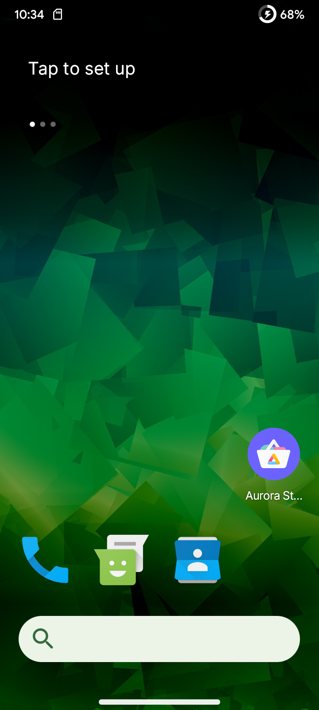
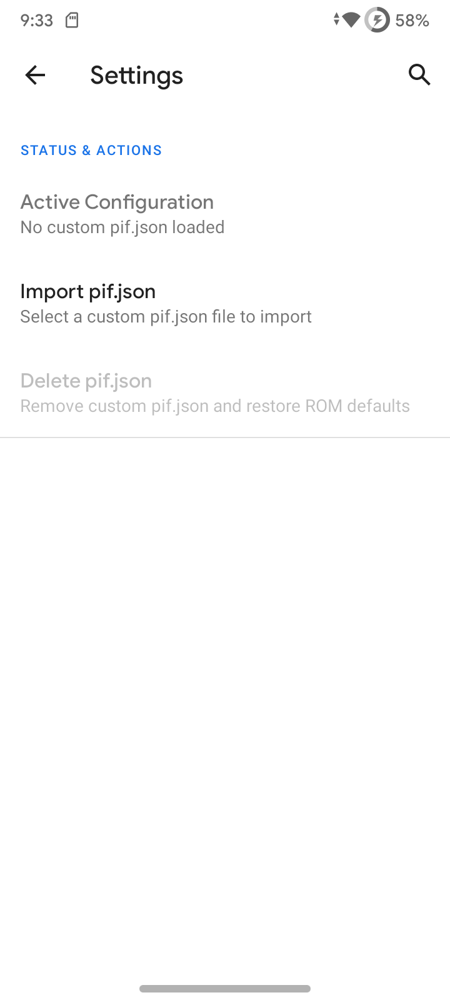
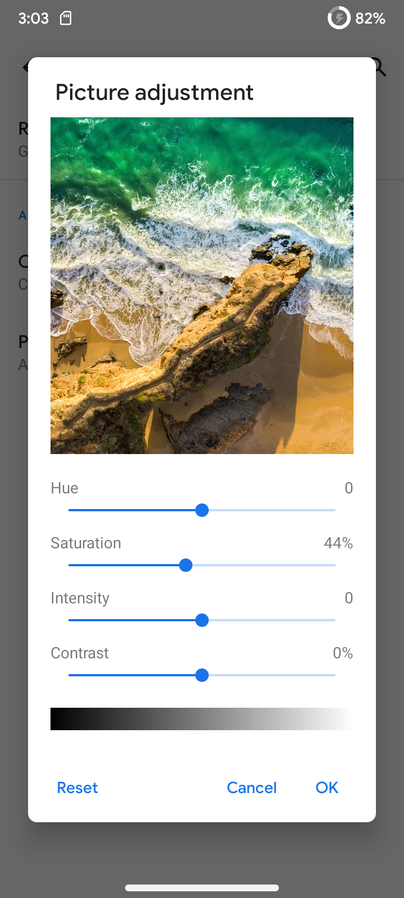
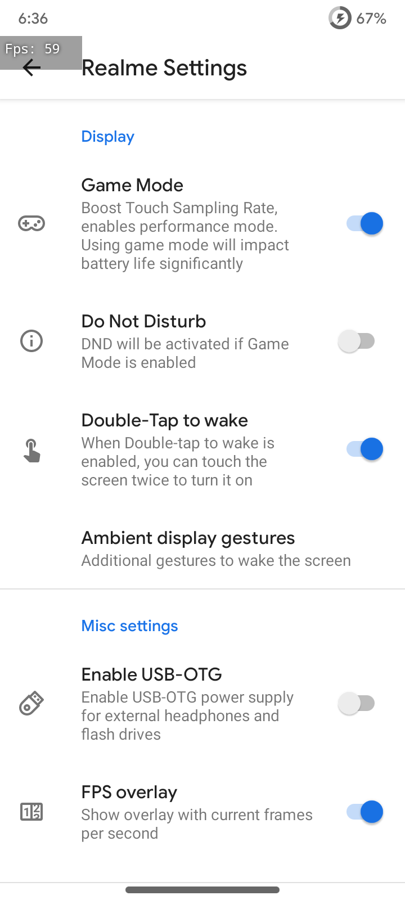

<div align="center">

# Realme Narzo 30A (RMX3171) - #keepQASSA [Unofficial]

[-3DDC84?style=flat-square&logo=android&logoColor=white)](https://android.com)
[](https://github.com/omi4real/Realme-Narzo-30A-RMX3171-keepQASSA-Unofficial)
[](https://github.com/keepQASSA)
[](https://github.com/omi4real/Realme-Narzo-30A-RMX3171-keepQASSA-Unofficial)
[](https://github.com/omi4real/Realme-Narzo-30A-RMX3171-keepQASSA-Unofficial)
[](https://github.com/omi4real)

A fast, daily-driver **Android 10 (Q) Custom ROM (Port)** for the **Realme Narzo 30A (`RMX3171`)**. Yes, Android 10 in the big '26 (**#keepQalive**), because modern OS bloat wasn't built for this hardware, and having instant app launches with two-day 6000mAh battery life beats chasing Android version numbers.

[**Downloads**](#downloads) • [**Screenshots**](#screenshots) • [**Flashing Guide**](#flashing-instructions) • [**Device Specs**](#device-specs) • [**What's Working**](#system-status) • [**Credits**](#credits) • [**Technical Bible**](./FINAL_RELEASE_SUMMARY.md)

</div>

---

> [!IMPORTANT]
> **Disclaimer & Unofficial Notice:** This is an **UNOFFICIAL** port and build for the Realme Narzo 30A (`RMX3171`). It is maintained independently by **omi4real** and is neither officially affiliated with nor endorsed by the official **[#keepQASSA](https://github.com/keepQASSA)** team.
> 
> This build is a direct port from the `RMX2020` base ROM (`qassa_Sisu-v2.4.s-RMX2020-20250617-0312-GApps-sign.zip`) originally built by **[@szyryjn](https://t.me/szyryjn)** on Telegram, with device trees and bringup groundwork by **[@sarthakroy](https://github.com/sarthakroy2002)** and **[@koushikdey](https://github.com/koushikdey)**. Full gratitude and credit belong to the original creators!

---

<a id="device-specs"></a>
## 📱 Device Specifications

| Parameter | Hardware Ground Truth (`RMX3171`) |
| :--- | :--- |
| **Device Model** | **Realme Narzo 30A (`RMX3171`)** |
| **Chipset (SoC)** | MediaTek MT6769Z Helio G85 (12nm, Octa-Core: 2x A75 @ 2.0GHz + 6x A55 @ 1.8GHz) |
| **GPU** | ARM Mali-G52 MC2 |
| **Display** | 6.5" IPS LCD (720 × 1600, 20:9, 60 Hz) |
| **Battery & Charging** | 6000 mAh Li-Po, 18W Fast Charging (governed dynamically) |
| **OS Userland** | Android 10.0 (Q, API Level 29, 64-bit ARM64) |
| **Port Base** | `RMX2020` (`qassa_Sisu-v2.4.s-RMX2020-20250617-0312-GApps-sign.zip` by @szyryjn) |
| **SELinux** | Permissive |

---

<a id="system-status"></a>
## ✅ System Status

**Tested and verified for daily-driver use.** Core subsystems, hardware HALs, and connectivity have been thoroughly validated on real device hardware:

- [x] **Cellular / RIL:** Phone calls, SMS, Dual-SIM VoLTE, 4G/LTE mobile data
- [x] **Wi-Fi:** 2.4 GHz & 5 GHz (Dual-band hotspot broadcasting unlocked)
- [x] **Bluetooth:** Audio streaming, media playback, BLE pairing
- [x] **Cameras:** Front & rear photo capture, video recording, flashlight
- [x] **Audio:** Loudspeaker, earpiece, microphone, 3.5mm headphone jack
- [x] **Biometrics:** Rear fingerprint scanner
- [x] **Sensors:** Accelerometer, proximity, light sensor
- [x] **Display:** Stock 60 Hz refresh rate (overclockable via custom kernel patcher tool)
- [x] **Storage & USB:** Internal storage, SD Card, USB-OTG
- [x] **Battery & Charging:** Fast charging with dynamic thermal governor (100% - 150%)
- [x] **Google Play Services:** GMS signature-safe self-updates, certified Play Store

---

<a id="highlights"></a>
## ⚡ Key Highlights & Port Enhancements

* **🛡️ Built-in Play Integrity Fix & Device Spoofing (`Settings -> Qassa -> Miscellaneous -> Spoof`):** Integrated spoofing suite baked directly into Settings, featuring Play Integrity Fix toggles, Google Photos unlimited original-quality backup, device fingerprint spoofing, and YouTube GMS spoofing out of the box.
* **🎨 LiveDisplay Picture Adjustment:** Full hardware RGB calibration and saturation sliders enabled in Settings without triggering MediaTek SurfaceFlinger hardware composer lockups.
* **📶 Dual-Band 5 GHz Hotspot (`wifi-service.jar`):** Overrode MediaTek stock constraints to allow full 5 GHz Wi-Fi hotspot broadcasting.
* **🔋 Dynamic Thermal-Charging Governor (`scripts/n30a_fixes_current.sh`):** Real-time background thermal daemon scaling charging speeds safely up to 150% below 38 °C and tapering down dynamically as thermals increase.
* **🚀 Overclockable Display Refresh Rate Tool:** Custom kernel MIPI DSI clock patcher tool that lets adventurous users overclock their display refresh rate beyond 60 Hz. Tooling and AnyKernel3 generators are hosted in the standalone [**Display OC Toolkit**](https://github.com/omi4real/Realme-Narzo-30A-Display-OC-Toolkit) repository *(⚠️ Experimental / Panel Lottery: Replacement panels vary widely; use at your own risk!)*.
* **⚙️ RealmeParts Hardware Suite:** Pre-baked device features app providing real-time FPS overlay, USB-OTG quick toggle, and hardware performance switches.
* **🔊 Extra Flashable Addons (Audio Boost & Game Unlocker):** Modular companion addons including loudspeaker acoustic gain boost (`N30A_AudioBoost_Magisk.zip`) and dynamic 90/120 FPS flagship game spoofing (`Infinix_GT50Pro_S25Ultra_GameUnlocker.zip`), hosted in the [**Magisk Addons**](https://github.com/omi4real/Realme-Narzo-30A-Magisk-Addons) repository.

---

<a id="screenshots"></a>
## 📸 Screenshots & UI Preview

| About Phone & Hardware | Homescreen & Launcher | Built-in Play Integrity & Spoofing | LiveDisplay Color HSIC | RealmeParts & Real-Time FPS |
| :---: | :---: | :---: | :---: | :---: |
|  |  |  |  |  |

---

<a id="downloads"></a>
## 📦 Downloads & Checksums

All flashable binaries, recovery packages, and companion addons are hosted on the **[Releases](https://github.com/omi4real/Realme-Narzo-30A-RMX3171-keepQASSA-Unofficial/releases)** page:

| Deliverable | File & MD5 Checksum |
| :--- | :--- |
| **Base ROM (Custom ROM Port)**<br><sub>Full flashable Android 10 OS (~1.07 GB)<br>*(RealmeParts, Unified Settings, 5GHz Hotspot & Color Fixes are pre-baked!)*</sub> | **File:** `qassa_Sisu-v2.4.s-RMX3171-20250617-0312-Vanilla-signed.zip`<br>**MD5:** `358b6c59918f7a2a2167317d3d5be199` |
| **Google Apps (LiteGapps)**<br><sub>Patched ARM64 native Play Services & Store (~64 MB)</sub> | **File:** `LiteGapps-arm64-10.0-RMX3171-Patched.zip`<br>**MD5:** `1f88d8c33284f7a7c7534283256f663b` |
| **Game Unlocker Addon (Optional)**<br><sub>Magisk high-FPS flagship spoof module (~4.4 MB)</sub> | **File:** [`Infinix_GT50Pro_S25Ultra_GameUnlocker.zip`](https://github.com/omi4real/Realme-Narzo-30A-Magisk-Addons/releases)<br>**MD5:** `4e31d218a1858317375261548705c8ab`<br><sub>Source: [Magisk Addons Repo](https://github.com/omi4real/Realme-Narzo-30A-Magisk-Addons)</sub> |
| **Audio Boost Addon (Optional)**<br><sub>Loudspeaker output boost Magisk module (~3 KB)</sub> | **File:** [`N30A_AudioBoost_Magisk.zip`](https://github.com/omi4real/Realme-Narzo-30A-Magisk-Addons/releases)<br>**MD5:** `e8ffbb0f5ffcc1061dab72e7fd6868b1`<br><sub>Source: [Magisk Addons Repo](https://github.com/omi4real/Realme-Narzo-30A-Magisk-Addons)</sub> |

> [!NOTE]
> **Display Overclocking:** Pre-built display overclock packages are intentionally omitted from public downloads because panel hardware tolerances vary significantly across replacement or factory LCDs. If you wish to build a customized display overclock package tuned for your own panel, use our standalone toolkit: [**Realme-Narzo-30A-Display-OC-Toolkit**](https://github.com/omi4real/Realme-Narzo-30A-Display-OC-Toolkit).

---

<a id="flashing-instructions"></a>
## 🛠️ Flashing Instructions

### Prerequisites
* Unlocked bootloader on **Realme Narzo 30A (`RMX3171`)**.
* Custom Recovery: **[Pitch Black Recovery Project (PBRP)](https://t.me/rmx3171important/406)** based on and for **Realme UI 1.0** *(Mandatory: our ROM is based on RUI 1.0)*.
* Full backup of personal data.
* Reference: [Community Flashing Guide for Realme Moon Devices](https://telegra.ph/Flashing-Guide-for-Realme-Moon-Devices-01-17) *(Follow the Realme UI 2.0 section in the guide, as the steps for our Realme UI 1.0 ROM are identical)*.

### Installation Steps
1. **Reboot to Recovery Mode** (PBRP for Realme UI 1.0).
2. **Flash the ROM ZIP:** Flash `qassa_Sisu-v2.4.s-RMX3171-20250617-0312-Vanilla-signed.zip`.
3. **Flash GApps (Optional):** Flash `LiteGapps-arm64-10.0-RMX3171-Patched.zip` *(Skip if you prefer pure Vanilla; flash if you need Play Store & Google services)*.
4. **Flash Magisk (Optional, Recommended):** Flash Magisk (v30.7 or latest) for root, modules, and extra addons.
5. **Format Data (MANDATORY):** Go to **Wipe** → **Format Data** → type `yes`. *(Do NOT skip this: format data is required to reset Android encryption and prevent bootloops!).*
6. **Reboot to System** & enjoy silky-smooth Android 10 performance!

---

## 📁 Repository Structure

```text
Realme-Narzo-30A-RMX3171-keepQASSA-Unofficial/
├── README.md                      # Project documentation & release overview
├── FINAL_RELEASE_SUMMARY.md       # Master reverse-engineering journal
├── LICENSE                        # Apache License 2.0 open-source license
├── scripts/                       # Charging daemon & system initialization tools
│   ├── n30a_fixes_current.sh      # Thermal charging daemon & system initialization
│   ├── rmx3171_charge_diag.sh     # Charging diagnostics & battery metrics tool
│   └── rmx3171.tweaks.rc          # Vendor init tweaks for Helio G85
└── screenshots/                   # Device verification & test screenshots
```

---

<a id="credits"></a>
## 🙏 Credits & Acknowledgements

* **[#keepQASSA Team](https://github.com/keepQASSA):** For the incredible `#keepQASSA` Android 10 ROM source, features, and philosophy (*"You already know what Q mean!"*).
* **[@szyryjn](https://t.me/szyryjn) on Telegram:** For the base `RMX2020` ROM build (`qassa_Sisu-v2.4.s-RMX2020-20250617-0312-GApps-sign.zip`), from which this Narzo 30A port was created.
* **[@sarthakroy](https://github.com/sarthakroy2002) & [@koushikdey](https://github.com/koushikdey):** Special thanks for the device trees and bringup groundwork.
* **[Realme C3 / Narzo 10A OSS Vendor Team](https://telegra.ph/Realme-C3Narzo-10A-OSS-Vendor-Credits-08-30):** For the vendor blobs, kernel fixes, and OSS tree components (see full vendor credits [here](https://telegra.ph/Realme-C3Narzo-10A-OSS-Vendor-Credits-08-30)).
* **[Pitch Black Recovery Project (PBRP)](https://t.me/rmx3171important/406):** For the Realme UI 1.0 custom recovery tree.
* **MediaTek & Realme Moon Community:** For testing, toolchains, and feedback.

---

<a id="technical-docs"></a>
## 📖 Deep Technical Documentation

> [!NOTE]
> For the complete reverse-engineering journal detailing the MediaTek SurfaceFlinger IPC fixes, smali register layouts, and GMS signature reconciliation, read [**`FINAL_RELEASE_SUMMARY.md`**](./FINAL_RELEASE_SUMMARY.md).

---

<div align="center">
Maintained with ❤️ by <b>omi4real</b>
</div>
