<div align="center">

# Realme Narzo 30A (RMX3171) - #keepQASSA [Unofficial]

[-3DDC84?style=flat-square&logo=android&logoColor=white)](https://android.com)
[](https://github.com/omi4real/Realme-Narzo-30A-RMX3171-keepQASSA-Unofficial)
[](https://github.com/keepQASSA)
[](https://github.com/omi4real/Realme-Narzo-30A-RMX3171-keepQASSA-Unofficial)
[](https://github.com/omi4real/Realme-Narzo-30A-RMX3171-keepQASSA-Unofficial)
[](https://github.com/omi4real)

A fast, daily-driver **Android 10 (Q) Custom ROM (Port)** for the **Realme Narzo 30A (`RMX3171`)**. Yes, Android 10 in the big '26 (**#keepQalive**), because modern OS bloat wasn't built for this hardware, and having instant app launches with two-day 6000mAh battery life beats chasing Android version numbers.

[**Downloads**](#downloads) • [**Highlights**](#highlights) • [**Device Specs**](#device-specs) • [**Screenshots**](#screenshots) • [**Flashing Guide**](#flashing-instructions) • [**What's Working**](#system-status) • [**Credits**](#credits)

</div>

---

> [!IMPORTANT]
> **Disclaimer & Unofficial Notice:** This is an **UNOFFICIAL** port and build for the Realme Narzo 30A (`RMX3171`). It is maintained independently by **omi4real** and is neither officially affiliated with nor endorsed by the official **[#keepQASSA](https://github.com/keepQASSA)** team.
> 
> This build is a direct port from the `RMX2020` base ROM (`qassa_Sisu-v2.4.s-RMX2020-20250617-0312-GApps-sign.zip`) originally built by **[@szyryjn](https://t.me/szyryjn)** on Telegram, with device trees and bringup groundwork by **[@sarthakroy](https://github.com/sarthakroy2002)** and **[@koushikdey](https://github.com/koushikdey)**. Full gratitude and credit belong to the original creators!

---

<a id="device-specs"></a>
## 📱 Device Specifications

| Parameter | Hardware Ground Truth (`RMX3171`) |
| :--- | :--- |
| **Device Model** | **Realme Narzo 30A (`RMX3171`)** |
| **Chipset (SoC)** | MediaTek MT6769Z Helio G85 (12nm, Octa-Core: 2x A75 @ 2.0GHz + 6x A55 @ 1.8GHz) |
| **GPU** | ARM Mali-G52 MC2 |
| **Display** | 6.5" IPS LCD (720 × 1600, 20:9, 60 Hz) |
| **Battery & Charging** | 6000 mAh Li-Po, 18W Fast Charging (governed dynamically) |
| **OS Userland** | Android 10.0 (Q, API Level 29, 64-bit ARM64) |
| **Port Base** | `RMX2020` (`qassa_Sisu-v2.4.s-RMX2020-20250617-0312-GApps-sign.zip` by @szyryjn) |
| **SELinux** | Permissive |

---

<a id="system-status"></a>
## ✅ System Status

**Tested and verified for daily-driver use.** Core subsystems, hardware HALs, and connectivity have been thoroughly validated on real device hardware:

- [x] **Cellular / RIL:** Phone calls, SMS, Dual-SIM VoLTE, 4G/LTE mobile data
- [x] **Wi-Fi:** 2.4 GHz & 5 GHz (Dual-band hotspot broadcasting unlocked)
- [x] **Bluetooth:** Audio streaming, media playback, BLE pairing
- [x] **Cameras:** Front & rear photo capture, video recording, flashlight
- [x] **Audio:** Loudspeaker, earpiece, microphone, 3.5mm headphone jack
- [x] **Biometrics:** Rear fingerprint scanner
- [x] **Sensors:** Accelerometer, proximity, light sensor
- [x] **Display:** Stock 60 Hz refresh rate (overclockable via custom kernel patcher tool)
- [x] **Storage & USB:** Internal storage, SD Card, USB-OTG
- [x] **Battery & Charging:** Fast charging with dynamic thermal governor (100% - 150%)
- [x] **Google Play Services:** GMS signature-safe self-updates, certified Play Store

---

<a id="highlights"></a>
## ⚡ Key Highlights & Port Enhancements

* **🛡️ Built-in Play Integrity Fix & Device Spoofing (`Settings -> Qassa -> Miscellaneous -> Spoof`):** Integrated spoofing suite baked directly into Settings, featuring Play Integrity Fix toggles, Google Photos unlimited original-quality backup, device fingerprint spoofing, and YouTube GMS spoofing out of the box.
* **🎨 LiveDisplay Picture Adjustment:** Full hardware RGB calibration and saturation sliders enabled in Settings without triggering MediaTek SurfaceFlinger hardware composer lockups.
* **📶 Dual-Band 5 GHz Hotspot (`wifi-service.jar`):** Overrode MediaTek stock constraints to allow full 5 GHz Wi-Fi hotspot broadcasting.
* **🔋 Fast Charging with Hardware Thermal Management (QC/PD up to 18W):** Native fast charging governed by the onboard Texas Instruments BQ2589x controller, delivering up to 9V @ 2A (18W) with dynamic Li-ion constant-voltage thermal tapering for cool operation and maximum battery lifespan.
* **🏠 Customized Shady Launcher with Google Search Switch:** Seamless toggle built into Launcher Home Settings, allowing instant switching between offline app search and Google App search.
* **⚙️ RealmeParts Hardware Suite:** Pre-baked device features app providing real-time FPS overlay, USB-OTG quick toggle, and hardware performance switches.
* **🔊 Loudspeaker & Earpiece Acoustic Boost Addon:** Hardware-calibrated MediaTek ALSA analog gain enhancement (+4 dB loudspeaker, +6 dB earpiece) available as a tested, non-destructive flashable module via our companion [Magisk Addons Suite](https://github.com/omi4real/Realme-Narzo-30A-Magisk-Addons).

---

<a id="screenshots"></a>
## 📸 Screenshots & UI Preview

### Core System & Interface
<table>
  <tr>
    <th width="20%" align="center">Homescreen</th>
    <th width="20%" align="center">App Drawer</th>
    <th width="20%" align="center">Settings Main</th>
    <th width="20%" align="center">About Phone</th>
    <th width="20%" align="center">Quick Settings</th>
  </tr>
  <tr>
    <td width="20%" align="center">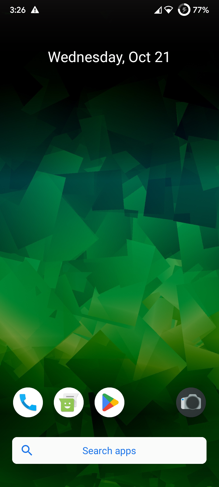</td>
    <td width="20%" align="center">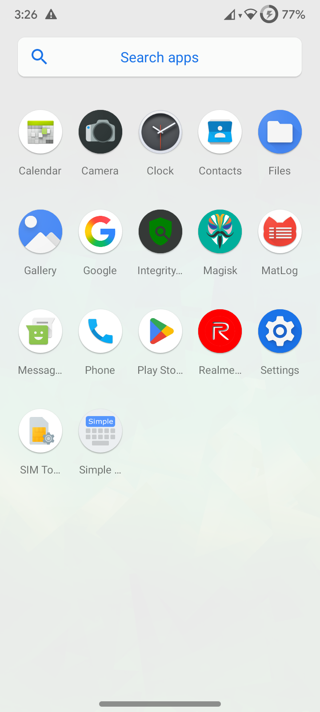</td>
    <td width="20%" align="center">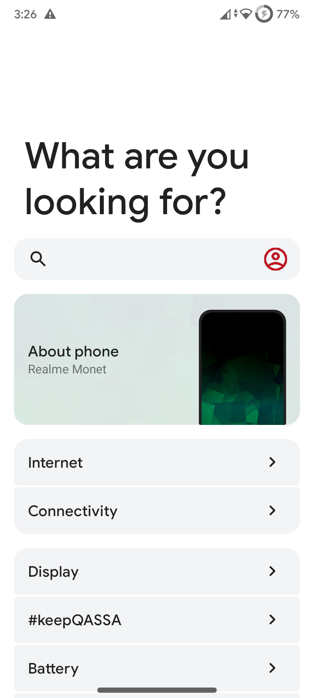</td>
    <td width="20%" align="center">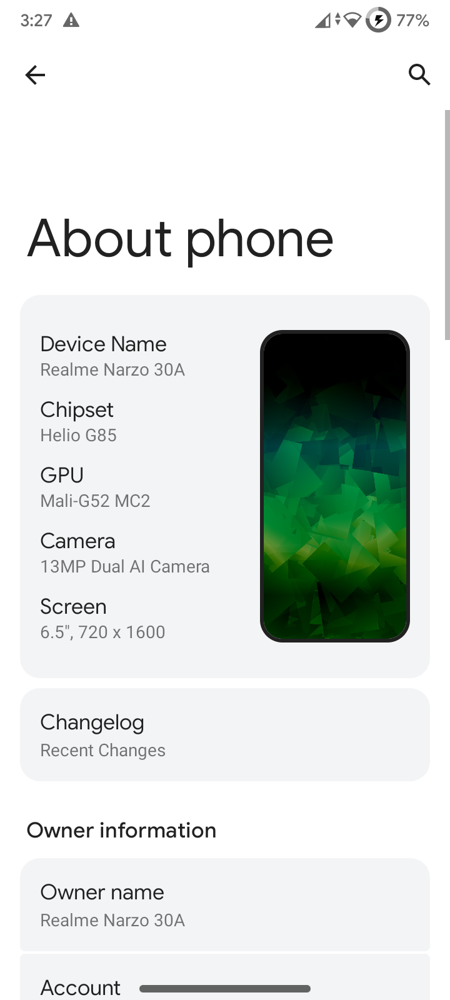</td>
    <td width="20%" align="center">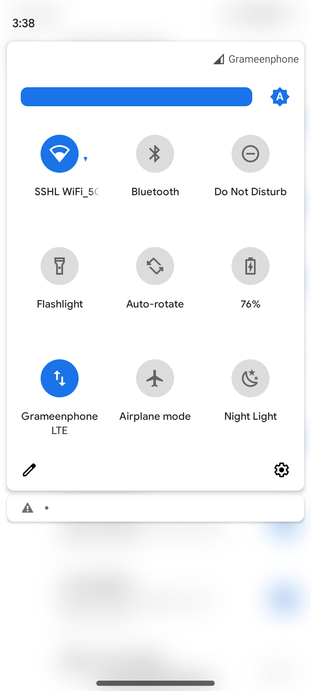</td>
  </tr>
</table>

### Customizations & Special Features
<table>
  <tr>
    <th width="20%" align="center">#keepQASSA Hub</th>
    <th width="20%" align="center">Spoofing Suite</th>
    <th width="20%" align="center">Play Integrity Fix</th>
    <th width="20%" align="center">LiveDisplay Color</th>
    <th width="20%" align="center">Search Bar Toggle</th>
  </tr>
  <tr>
    <td width="20%" align="center">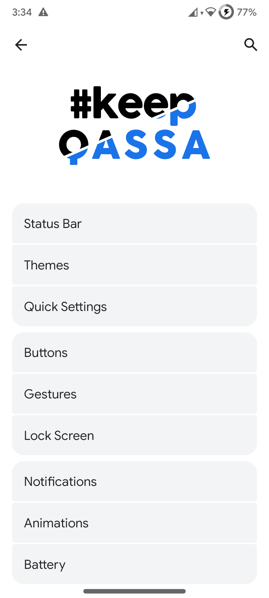</td>
    <td width="20%" align="center">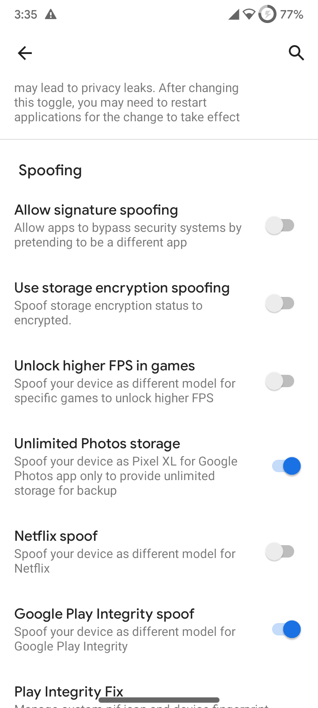</td>
    <td width="20%" align="center">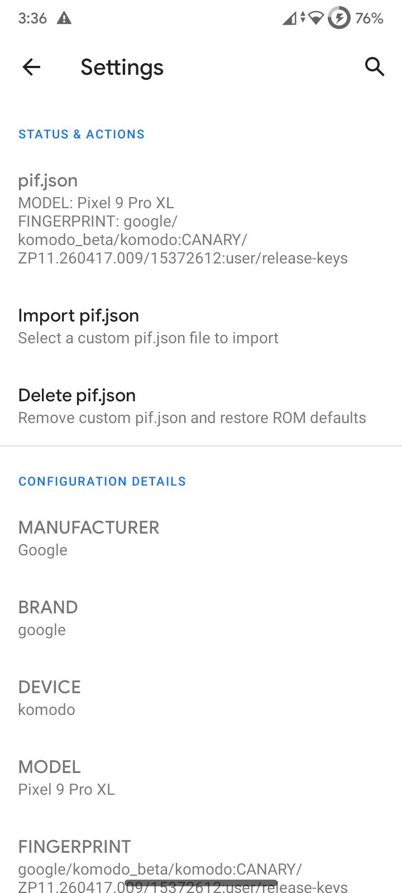</td>
    <td width="20%" align="center">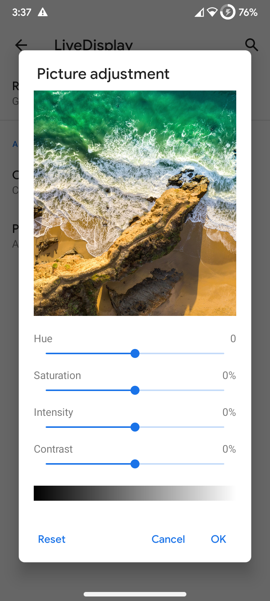</td>
    <td width="20%" align="center">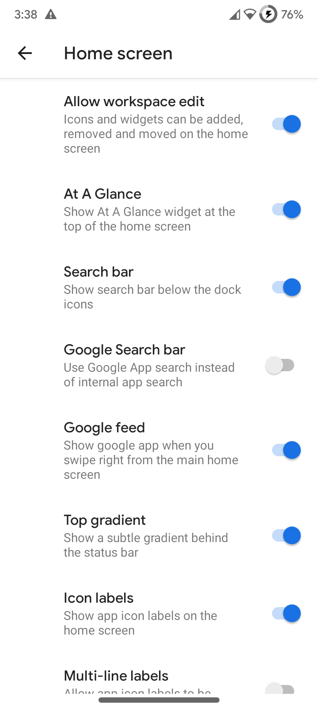</td>
  </tr>
</table>

### RealmeParts & Hardware Diagnostics
<table width="100%">
  <tr>
    <th width="33.33%" align="center">Realme Settings Hub</th>
    <th width="33.33%" align="center">FPS Meter Active</th>
    <th width="33.33%" align="center">Real-Time FPS on Homescreen</th>
  </tr>
  <tr>
    <td width="33.33%" align="center">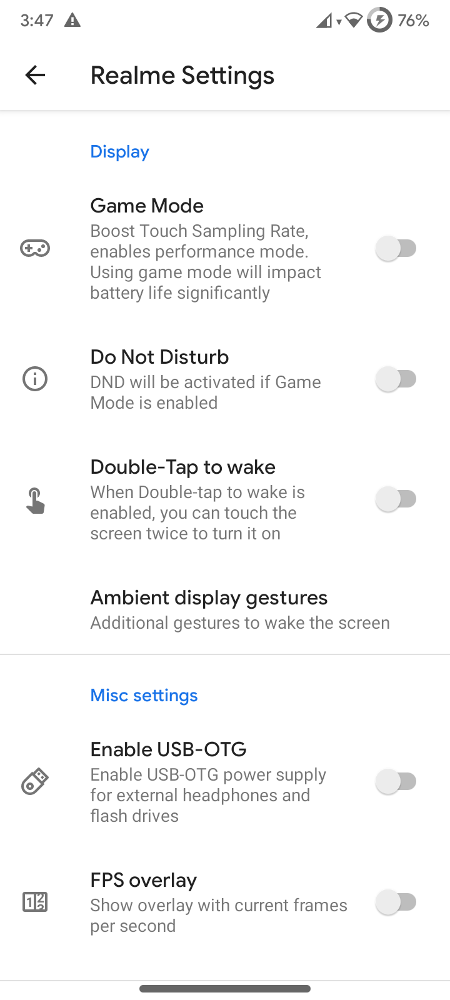</td>
    <td width="33.33%" align="center">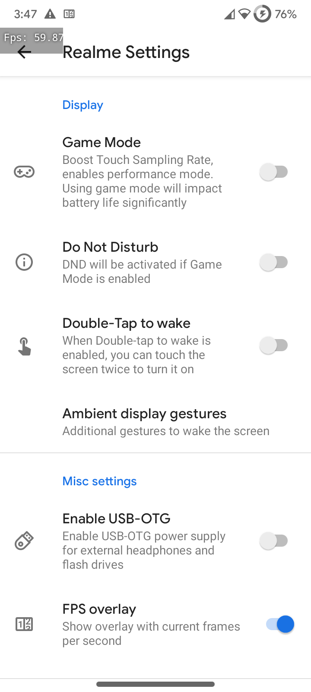</td>
    <td width="33.33%" align="center">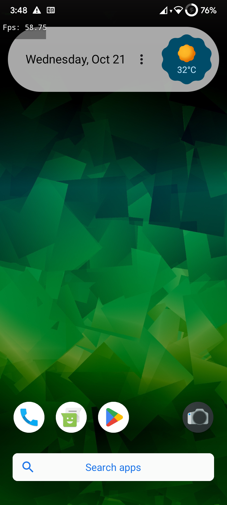</td>
  </tr>
</table>

---

<a id="downloads"></a>
## 📦 Downloads & Checksums

All flashable binaries and packages are hosted on the **[Releases (v2.4.s-RMX3171)](https://github.com/omi4real/Realme-Narzo-30A-RMX3171-keepQASSA-Unofficial/releases/tag/v2.4.s-RMX3171)** page:

| Deliverable | File & MD5 Checksum |
| :--- | :--- |
| **Pre-baked GApps ROM (Recommended)**<br><sub>Full flashable Android 10 OS (~1.10 GB)<br>*(Google Play Store & GMS pre-integrated into system, zero recovery flash issues!)*</sub> | **File:** [`qassa_Sisu-v2.4.s-RMX3171-20250617-0312-GApps-signed.zip`](https://github.com/omi4real/Realme-Narzo-30A-RMX3171-keepQASSA-Unofficial/releases/download/v2.4.s-RMX3171/qassa_Sisu-v2.4.s-RMX3171-20250617-0312-GApps-signed.zip)<br>**MD5:** `4bd9e0ad32461f5e3294b012d3575dc4` |
| **Vanilla ROM (Clean / MicroG)**<br><sub>Full flashable Android 10 OS (~1.09 GB)<br>*(Super clean, bloat-free base. Ideal for MicroG or privacy setups)*</sub> | **File:** [`qassa_Sisu-v2.4.s-RMX3171-20250617-0312-Vanilla-signed.zip`](https://github.com/omi4real/Realme-Narzo-30A-RMX3171-keepQASSA-Unofficial/releases/download/v2.4.s-RMX3171/qassa_Sisu-v2.4.s-RMX3171-20250617-0312-Vanilla-signed.zip)<br>**MD5:** `733dc899d1d8ccef5ddcb308ac77d6a9` |
| **Google Apps (Patched LiteGapps)**<br><sub>Standalone fallback ARM64 native Play Services & Store (~64 MB)</sub> | **File:** [`LiteGapps-arm64-10.0-RMX3171-Patched.zip`](https://github.com/omi4real/Realme-Narzo-30A-RMX3171-keepQASSA-Unofficial/releases/download/v2.4.s-RMX3171/LiteGapps-arm64-10.0-RMX3171-Patched.zip)<br>**MD5:** `1f88d8c33284f7a7c7534283256f663b` |
| **Audio Boost Addon (Optional)**<br><sub>Hardware-calibrated MediaTek analog gain boost (+4dB speaker / +6dB earpiece, ~5.4 KB)</sub> | **File:** [`N30A_AudioBoost_Magisk.zip`](https://github.com/omi4real/Realme-Narzo-30A-RMX3171-keepQASSA-Unofficial/releases/download/v2.4.s-RMX3171/N30A_AudioBoost_Magisk.zip)<br>**MD5:** `bedf0e69d2a69aa2e1836b2ca42abd97`<br>*(Source & suite: [Realme-Narzo-30A-Magisk-Addons](https://github.com/omi4real/Realme-Narzo-30A-Magisk-Addons))* |

> [!NOTE]
> ### 💡 Which ROM Package Should You Choose?
> * **Pre-baked GApps ROM (Strongly Recommended for Google Users):** Due to Android 10 System-as-Root (SAR) fixed physical partition sizing and read-only mount constraints, split-APK signature verifications, and Play Store permission reconciliation, flashing third-party GApps zip packages from custom recovery often triggers Play Store permission crashes or bootloops. If you intend to use Google Play Store, Gmail, Google Photos, or Google account sync, flash the **Pre-baked GApps ROM** — Google Services are pre-integrated directly into `/system/product/priv-app/` with verified SELinux contexts and permissions for a 100% stable out-of-the-box experience.
> * **Vanilla ROM (Ideal for Clean / MicroG / FOSS Setups):** If you prefer a completely de-Googled, bloat-free system, or use MicroG / Aurora Store / F-Droid, flash the **Vanilla ROM**. It contains zero Google telemetry or background services, maximizing battery longevity and RAM availability. *(Note: Flashing standard external OpenGApps or NikGApps over Vanilla is NOT recommended due to recovery-level permission conflicts).*
> * **Patched LiteGapps Package (Verified Fallback):** For users who initially flashed Vanilla and subsequently decide to install Google Play Services without wiping their system, we provide our pre-patched `LiteGapps-arm64-10.0-RMX3171-Patched.zip`. Its installer script has been specifically adapted to mount our SAR `/system` and `/product` partitions cleanly and configure Play Store permissions without breaking integrity.

---

<a id="flashing-instructions"></a>
## 🛠️ Flashing Instructions

### Prerequisites
* **⚠️ Mandatory Firmware Base:** Device **MUST** be on **Stock Realme UI 1.0 (Android 10)** firmware (e.g. `A.17`, `A.19`, or `A.21`) before flashing PBRP and this ROM. *(If you are currently running Realme UI 2.0 / Android 11, you must roll back to Stock Realme UI 1.0 first, or you will encounter recovery fastboot loops or broken touchscreen!).*
* Unlocked bootloader on **Realme Narzo 30A (`RMX3171`)**.
* Custom Recovery: **[Pitch Black Recovery Project (PBRP)](https://t.me/rmx3171important/406)** based on and for **Realme UI 1.0** *(Mandatory: our ROM is based on RUI 1.0)*.
* Full backup of personal data.
* Reference: [Community Flashing Guide for Realme Moon Devices](https://telegra.ph/Flashing-Guide-for-Realme-Moon-Devices-01-17) *(Follow the Realme UI 2.0 section in the guide, as the steps for our Realme UI 1.0 ROM are identical)*.

### Installation Steps
1. **Reboot to Recovery Mode** (PBRP for Realme UI 1.0).
2. **Flash the ROM ZIP directly:** *(Do NOT manually wipe system or vendor partitions in recovery; the ROM installer flashes the raw block image cleanly!)*
   - **For Google Services / Play Store (Recommended):** Flash `qassa_Sisu-v2.4.s-RMX3171-20250617-0312-GApps-signed.zip`.
   - **For Clean Experience / MicroG:** Flash `qassa_Sisu-v2.4.s-RMX3171-20250617-0312-Vanilla-signed.zip`.
3. **Flash Magisk (Optional):** Flash Magisk (v30.7 or latest) if you want root access or Magisk modules. *(Note: Our built-in device spoofing already handles Google Play Integrity out of the box without needing Magisk!).*
4. **Format Data (MANDATORY):** Go to **Wipe** → **Format Data** → type `yes`. *(Do NOT skip this: format data is required to reset Android encryption and prevent bootloops!).*
5. **Reboot to System** & enjoy silky-smooth Android 10 performance!

---

## 📁 Repository Structure

```text
Realme-Narzo-30A-RMX3171-keepQASSA-Unofficial/
├── README.md                      # Project documentation & release overview
├── LICENSE                        # Apache License 2.0 open-source license
└── screenshots/                   # Device verification & showcase screenshots
```

---

<a id="credits"></a>
## 🙏 Credits & Acknowledgements

* **[#keepQASSA Team](https://github.com/keepQASSA):** For the incredible `#keepQASSA` Android 10 ROM source, features, and philosophy (*"You already know what Q mean!"*).
* **[@szyryjn](https://t.me/szyryjn) on Telegram:** For the base `RMX2020` ROM build (`qassa_Sisu-v2.4.s-RMX2020-20250617-0312-GApps-sign.zip`), from which this Narzo 30A port was created.
* **[@sarthakroy](https://github.com/sarthakroy2002) & [@koushikdey](https://github.com/koushikdey):** Special thanks for the device trees and bringup groundwork.
* **[Realme C3 / Narzo 10A OSS Vendor Team](https://telegra.ph/Realme-C3Narzo-10A-OSS-Vendor-Credits-08-30):** For the vendor blobs, kernel fixes, and OSS tree components (see full vendor credits [here](https://telegra.ph/Realme-C3Narzo-10A-OSS-Vendor-Credits-08-30)).
* **Pitch Black Recovery Project (PBRP) Team:** For the Realme UI 1.0 custom recovery tree and community recovery support.
* **MediaTek & Realme Moon Community:** For testing, toolchains, and feedback.

---

<div align="center">
Maintained with ❤️ by <b>omi4real</b>
</div>
